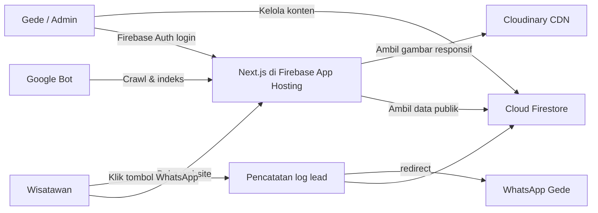
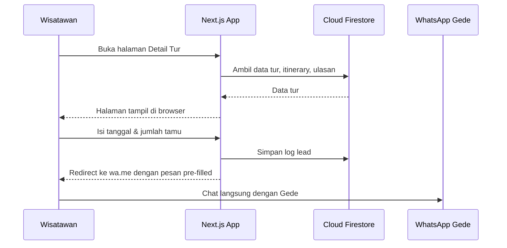
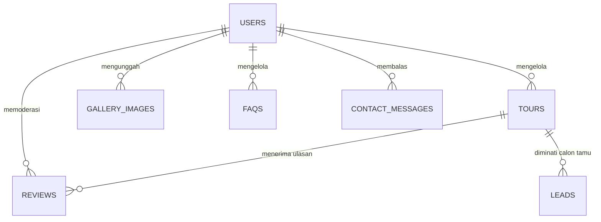

# PRD — Project Requirements Document

## 1. Overview

**Masalah yang ingin diselesaikan**

Wisatawan domestik maupun mancanegara yang mencari private tour guide di Bali sering kali hanya menemukan produk di marketplace seperti Klook, Airbnb, atau hasil pencarian Google yang tidak personal. Mereka ragu karena tidak tahu siapa pemandu aslinya, bagaimana kredibilitasnya, dan apakah tur bisa disesuaikan dengan keinginan mereka. Di sisi lain, Gede Sudiartana—tour guide independen berlisensi HPI Bali—masih mengandalkan pesanan dari tempat kerjanya dan tidak memiliki media promosi mandiri.

**Tujuan utama**

Membangun personal branding website untuk Gede yang:
1. Menampilkan kredibilitas, pengalaman, lisensi, dan kepribadian Gede secara langsung kepada calon tamu.
2. Menjadi katalog tur privat dengan harga jelas, itinerary, dan informasi praktis.
3. Mengalihkan pemesanan dari marketplace ke **Direct-to-WhatsApp Funnel**, sehingga calon tamu bisa ngobrol langsung dengan Gede tanpa komisi perantara.
4. Tidak menggunakan payment gateway—semua komunikasi, negosiasi, dan kesepakatan transaksi dilakukan melalui WhatsApp.

**Pendekatan desain**

Luxury Travel Editorial yang hangat, elegan, dan ramah khas Bali, mobile-first, dengan warna kanvas *warm cream* (`#FEFDFB`), dominan hijau alam Bali (`#0C8C5E`), biru ocean trust (`#1878B8`), dan aksen tombol CTA WhatsApp Sunset Amber (`#E67E22`). Judul memakai serif editorial **Libre Baskerville**, sedangkan teks dan UI memakai **Inter**.

**Kemenangan pertama produk**

Calon tamu yang datang ke website dapat dengan cepat melihat setidaknya satu tur yang cocok, lalu mengklik tombol WhatsApp dengan pesan yang sudah berisi tur pilihan, tanggal, dan jumlah tamu.

---

## 2. Requirements

Berikut persyaratan utama yang menjadi acuan pengembangan:

**Halaman publik**
- Tersedia halaman: Home (`/`), Katalog Tur (`/tours`), Detail Tur (`/tours/[slug]`), About (`/about`), Gallery (`/gallery`), Reviews (`/reviews`), Contact (`/contact`), dan FAQ (`/faq`).
- Semua halaman publik harus mobile-first dan nyaman digunakan di perangkat HP.
- Tombol WhatsApp mengambang bernuansa Sunset Amber (#E67E22) dengan aksen hijau alam harus selalu terlihat di semua halaman publik.

**Funnel pemesanan langsung**
- Tombol CTA pada kartu tur maupun halaman detail tur mengarah ke WhatsApp Gede.
- Pesan WhatsApp dibuat otomatis berisi nama tur, tanggal, dan jumlah tamu.
- Pengunjung yang hanya ingin bertanya tetap bisa membuka chat WhatsApp tanpa mengisi formulir.
- Tidak ada sistem pembayaran online di dalam website.

**Kredibilitas**
- Website menampilkan lisensi resmi HPI Bali, pengalaman Gede, standar armada mobil ber-AC, testimoni bintang lima, dan foto dokumentasi asli.

**Admin**
- Hanya Gede sebagai satu admin yang dapat masuk ke panel admin melalui Firebase Auth.
- Admin dapat mengelola tur, galeri, moderasi ulasan, dan melihat log calon tamu yang menekan tombol WhatsApp/mini-form.

**Media**
- Semua foto dikelola melalui Cloudinary dengan kompresi dan format responsif WebP/AVIF.
- Firebase Storage tidak digunakan untuk penyimpanan media.

**SEO & Metadata**
- Setiap halaman memiliki judul unik, deskripsi 140–160 karakter, serta Open Graph/Twitter Card.
- Struktur data JSON-LD dipasang: LocalBusiness di Home, TouristTrip + Offer di Detail Tur, Person di About, dan FAQPage di FAQ.
- Tersedia `sitemap.ts` dan `robots.txt` dinamis.

---

## 3. Core Features

Fitur-fitur di bawah mengikuti roadmap yang telah disepakati dan dikelompokkan per fase. Seluruh fitur tetap menjadi bagian dari produk akhir.

### Fase 1 — Pondasi Homepage, Katalog, dan WhatsApp Funnel

**Beranda**
- **Sapaan & Foto Utama** — Menampilkan foto asli Bali dan sapaan hangat agar wisatawan langsung merasa diterima.
- **Kepercayaan Sekilas** — Memperlihatkan pengalaman, lisensi HPI, dan kendaraan ber-AC.
- **Tur & Destinasi Pilihan** — Menyorot beberapa tur favorit dan destinasi populer.
- **Testimoni Singkat** — Menampilkan kesan tamu sebelumnya sebagai bukti sosial.
- **Ajakan WhatsApp** — Tombol Sunset Amber (#E67E22) untuk langsung tanya atau pesan ke Gede.

**Halaman Utama**
- **Hero & Pesan Utama** — Foto Bali yang hangat dengan kalimat jelas bahwa tur privat bisa dipesan langsung bersama Gede.
- **Tur Unggulan di Depan** — Beberapa tur pilihan muncul di halaman depan agar calon tamu cepat menemukan kandidat tur.
- **Inspirasi Destinasi** — Menampilkan destinasi populer Bali untuk memicu minat liburan.
- **Testimoni Secukupnya** — Kutipan ulasan bintang lima sebagai kredibilitas sejak detik pertama.
- **Alasan Direct Booking** — Menjelaskan keuntungan ngobrol langsung dengan Gede dan bebas biaya perantara.

**Jelajahi Tur**
- **Daftar Semua Tur** — Kartu tur menampilkan nama, durasi, area, dan harga agar mudah dibandingkan.
- **Filter Area & Kategori** — Menyaring tur berdasarkan area atau jenis kegiatan.
- **Urutan Tur Populer** — Tur yang paling diminati tampil lebih dulu.

**Detail Tur**
- **Rencana Perjalanan** — Agenda tur bertahap dari awal sampai akhir sesuai durasi paket.
- **Termasuk & Tidak Termasuk** — Menjelaskan apa saja yang tersedia dan yang perlu disiapkan tamu.
- **Lokasi di Peta** — Google Maps disematkan untuk menunjukkan area tur atau titik penjemputan.
- **Detail Harga & Kuota** — Harga per orang/kelompok serta jumlah tamu minimum dan maksimum.

**Pesan WhatsApp**
- **Tombol WhatsApp Mengambang** — Tombol Sunset Amber (#E67E22) di pojok layar pada semua halaman publik.
- **Pesan Otomatis untuk Tur** — Saat CTA di halaman tur diklik, WhatsApp terbuka dengan pesan berisi nama tur.
- **Isi Tanggal & Jumlah Tamu** — Form singkat untuk memilih tanggal dan jumlah tamu lalu diarahkan ke chat Gede.
- **Langsung Tanya Tanpa Isi Form** — Pengunjung tetap bisa chat WhatsApp tanpa mengisi data apa pun.

---

### Fase 2 — Kepercayaan, Katalog Lengkap, dan Kontak

**Bukti Kepercayaan**
- **Cerita Gede** — Menjelaskan siapa Gede, pengalamannya, dan kesukaannya memandu wisatawan.
- **Lisensi & Kenyamanan** — Menampilkan lisensi HPI resmi dan standar armada ber-AC.
- **Galeri Dokumentasi** — Foto asli suasana tur dan destinasi Bali.
- **Ulasan Bintang Lima** — Rating dan komentar tamu sebagai bukti pelayanan.

**Kontak & FAQ**
- **Formulir Pesan** — Form cadangan untuk kebutuhan non-darurat tanpa harus membuka WhatsApp.
- **Pertanyaan Umum** — Tanya jawab seputar harga, jadwal, dan hal-hal yang sering membuat ragu.
- **Info Kontak Gede** — Nomor WhatsApp, email, dan media sosial yang bisa dihubungi.

**Katalog Tur**
- **Daftar Semua Tur** — Seluruh tur privat tampil dalam kartu dengan harga dan durasi yang jelas.
- **Filter Kategori & Area** — Menyaring daftar berdasarkan jenis tur atau wilayah Bali.
- **Pencarian Cepat** — Pengunjung dapat mencari langsung nama tur atau area.
- **Harga Transparan** — Harga final tanpa biaya perantara sesuai konsep direct booking.

**Detail Tur**
- **Rencana Perjalanan Rinci** — Itinerary per titik atau jam agar tamu bisa membayangkan pengalaman tur.
- **Inklusi & Eksklusi** — Daftar jelas apa saja yang sudah termasuk atau tidak termasuk dalam harga.
- **Peta Lokasi Tur** — Google Maps menunjukkan area jemput atau lokasi tur.
- **Sorotan Pengalaman** — Keunikan setiap tur ditonjolkan agar calon tamu semakin yakin.

**Pesan WhatsApp**
- **Tombol WhatsApp Melayang** — Selalu terlihat di sudut layar pada setiap halaman.
- **Pesan Otomatis Sesuai Halaman** — Draf pesan berisi nama tur, tanggal, dan jumlah tamu.
- **Mini-Form Pemesanan** — Formulir kecil untuk memilih tur, tanggal, dan jumlah tamu.
- **Akses Chat dari Kartu Tur** — Ikon WhatsApp pada setiap kartu tur agar bisa chat tanpa membuka halaman detail.

---

### Fase 3 — Panel Admin, Profil Pemandu, Galeri, dan Bantuan

**Panel Admin**
- **Masuk Khusus Admin** — Halaman panel dikunci dan hanya bisa diakses Gede.
- **Kelola Paket Tur** — Menambah, menyunting, atau menghapus tur beserta harga dan agenda.
- **Kelola Galeri & Ulasan** — Mengunggah foto baru dan menyetujui ulasan sebelum tampil publik.
- **Catatan Calon Tamu** — Melihat daftar orang yang mengirim pesan lewat WhatsApp agar mudah ditindaklanjuti.

**Profil Pemandu**
- **Cerita Gede** — Pengalaman Gede sebagai tour guide asli Bali yang ramah dan profesional.
- **Lisensi HPI Bali** — Kredensial resmi agar wisatawan merasa aman dan percaya.
- **Standar Kenyamanan Armada** — Penjelasan mobil ber-AC dan fasilitas selama perjalanan.
- **Kenapa Memesan Langsung** — Keuntungan tanpa perantara dan bisa ngobrol langsung dengan Gede.

**Galeri & Ulasan**
- **Album Dokumentasi** — Kumpulan foto perjalanan yang diatur rapi.
- **Testimoni Bintang 5** — Ulasan asli dengan rating bintang lima dan cerita pengalaman.
- **Sorotan Pengalaman Tamu** — Momen atau kutipan terbaik agar calon tamu merasa dekat.

**Kontak & Bantuan**
- **Formulir Pesan Cadangan** — Formulir kontak sederhana untuk pertanyaan yang tidak ingin lewat WhatsApp.
- **Akordeon FAQ** — Daftar pertanyaan umum dengan jawaban yang mudah dibuka.
- **Info Kontak Langsung** — Nomor WhatsApp, email, dan media sosial Gede.

---

### Fase 4 — SEO Google dan Penyempurnaan Admin

**Tampil di Google**
- **Judul & Ringkasan Tiap Halaman** — Setiap halaman punya judul dan keterangan singkat yang berbeda di hasil pencarian.
- **Data Tur untuk Google** — Google menerima rincian tur, harga, dan lokasi agar tampil menarik di pencarian.
- **Data Toko & Profil** — Info Gede sebagai pemandu dan bisnis lokal yang jelas.
- **Peta Situs Website** — `sitemap.ts` dan `robots.txt` dinamis agar semua halaman mudah ditemukan mesin pencari.

**Panel Admin**
- **Login Admin** — Gerbang aman agar hanya Gede yang bisa masuk ke panel.
- **Kelola Paket Tur** — Menambah, mengubah, dan menonaktifkan tur di katalog.
- **Kelola Galeri** — Mengunggah dan menghapus foto dokumentasi untuk galeri publik.
- **Moderasi Ulasan** — Menyetujui atau menolak ulasan sebelum tampil ke publik.
- **Lihat Log Lead** — Mencatat dan menampilkan klik WhatsApp atau pengiriman mini-form dari pengunjung.

---

## 4. User Flow

**Alur utama wisatawan: menemukan tur lalu memesan via WhatsApp**

1. Wisatawan membuka website melalui Google, media sosial, atau referensi teman.
2. Di beranda, ia langsung melihat sapaan hangat, foto Bali, trust bar pengalaman Gede, serta tur unggulan.
3. Jika tertarik pada salah satu tur, ia mengklik kartu tur dan masuk ke halaman **Detail Tur**.
4. Ia membaca rencana perjalanan, daftar inklusi/eksklusi, harga, kuota, dan lokasi di peta.
5. Di halaman detail tur, ia mengisi mini-form: memilih tanggal, jumlah tamu, lalu menekan **“Pesan via WhatsApp”**.
6. WhatsApp Gede terbuka dengan pesan otomatis berisi nama tur, tanggal, jumlah tamu, dan sapaan.
7. Gede membalas, berdiskusi, lalu kesepakatan tur dan pembayaran diselesaikan langsung melalui chat.
8. Jika wisatawan belum siap memesan, ia bisa menekan tombol WhatsApp mengambang di pojok layar untuk bertanya dulu tanpa mengisi form.

**Alur pengunjung yang baru mencari inspirasi**

1. Pengunjung masuk ke beranda dan melihat inspirasi destinasi populer.
2. Ia mengklik destinasi atau tur yang menarik, lalu menyimpan website sebagai referensi liburan.
3. Pada kunjungan berikutnya, ia memilih tur yang cocok dan melanjutkan ke alur WhatsApp.

**Alur admin: Gede**

1. Gede membuka `/admin` dan masuk menggunakan Firebase Auth.
2. Dashboard admin menampilkan ringkasan log lead yang masuk.
3. Gede membuka log lead dari wisatawan yang sudah mengklik WhatsApp/mini-form.
4. Gede menambah atau mengubah paket tur, mengunggah foto galeri, dan memoderasi ulasan.
5. Setiap perubahan konten langsung memperbarui halaman publik.

---

## 5. Architecture

Arsitektur aplikasi menggunakan **Next.js di Firebase App Hosting** sebagai lapisan utama. Halaman publik dirender oleh server (SSR/ISR) dengan mengambil data dari **Cloud Firestore**, sedangkan media diambil dari **Cloudinary**. Semua ajakan WhatsApp diarahkan ke `wa.me` dengan pesan pre-filled, dan aktivitas pemesanan dicatat sebagai log lead sebelum pengunjung diarahkan ke WhatsApp.

**Komponen utama:**

- **Firebase App Hosting** — Menjalankan aplikasi Next.js, mendukung SSR dan ISR.
- **Firebase Auth** — Autentikasi khusus satu admin, yaitu Gede.
- **Cloud Firestore** — Database utama untuk tur, ulasan, galeri, FAQ, pesan kontak, dan log lead.
- **Cloudinary** — Penyimpanan dan pengiriman gambar teroptimasi. Firebase Storage tidak dipakai.
- **WhatsApp** — Saluran komunikasi dan transaksi utama. Tidak ada payment gateway.
- **Google Bot** — Crawler Google membaca halaman yang sudah dilengkapi sitemap, metadata, dan JSON-LD.

Alur teknis pemesanan:

**Catatan arsitektur**

- Data publik tidak dibaca langsung oleh browser; halaman dirender di server agar cepat, aman, dan SEO-friendly.
- Setelah admin mengubah konten, halaman publik di-revalidate agar informasi tur tidak basi.
- Tombol WhatsApp pada halaman apa pun melewati proses pencatatan di Firestore lalu diarahkan ke WhatsApp.

---

## 6. Database Schema

Database menggunakan **Cloud Firestore**, yaitu database NoSQL berbasis dokumen. Konsep “tabel” di sini disebut **collection**, dan setiap baris disebut **dokumen**.

### `users`
Dokumen admin Gede—doc ID sama dengan Firebase Auth UID.

| Field | Tipe | Kegunaan |
|---|---|---|
| `email` | string | Email login admin |
| `name` | string | Nama lengkap Gede |
| `role` | string | Nilai `admin` |
| `isActive` | boolean | Menandakan akun aktif |
| `createdAt` | timestamp | Waktu akun dibuat |

### `tours`
Data setiap paket tur publik.

| Field | Tipe | Kegunaan |
|---|---|---|
| `slug` | string | URL unik, misal `ubud-private-tour` |
| `name` | string | Nama tur |
| `tagline` | string | Kalimat singkat pemikat |
| `description` | string | Deskripsi panjang tur |
| `category` | string | Jenis tur, misal *culture*, *nature*, *honeymoon* |
| `area` | string | Wilayah Bali, misal Ubud, Uluwatu, Bedugul |
| `duration` | string | Durasi, misal “10 jam” |
| `price` | number | Harga tur sesuai `priceType` |
| `priceType` | string | `per_person` atau `per_group` |
| `currency` | string | Mata uang, misal `IDR` atau `USD` |
| `minimumGuests` | number | Jumlah tamu minimum |
| `maximumGuests` | number | Jumlah tamu maksimum |
| `itinerary` | array of object | Rencana perjalanan tahap demi tahap: `{ time, title, description }` |
| `includes` | array of string | Fasilitas yang sudah termasuk |
| `excludes` | array of string | Hal yang belum termasuk |
| `highlights` | array of string | Sorotan pengalaman unik tur |
| `mapEmbedUrl` | string | Link embed Google Maps |
| `pickupLocation` | string | Lokasi penjemputan umum |
| `coverImage` | string | Public ID/link gambar utama di Cloudinary |
| `galleryImages` | array of string | Foto pendukung tur |
| `featured` | boolean | Menentukan tur unggulan di homepage |
| `isActive` | boolean | Status publish/nonaktif |
| `createdAt` | timestamp | Waktu dibuat |
| `updatedAt` | timestamp | Waktu terakhir diubah |

### `reviews`
Ulasan dari tamu, termasuk yang sudah dan belum disetujui admin.

| Field | Tipe | Kegunaan |
|---|---|---|
| `tourId` | string | Opsional—acuan dokumen tur yang diulas |
| `authorName` | string | Nama tamu |
| `authorOrigin` | string | Asal tamu, misal Australia |
| `rating` | number | Rating 1–5, umumnya 5 |
| `content` | string | Isi testimoni |
| `dateOfTrip` | timestamp | Tanggal tur dijalankan |
| `isApproved` | boolean | Status moderasi; belum tampil sampai disetujui |
| `featured` | boolean | Testimoni yang ditampilkan di homepage |
| `createdAt` | timestamp | Waktu ulasan masuk |

### `gallery_images`
Foto dokumentasi galeri.

| Field | Tipe | Kegunaan |
|---|---|---|
| `cloudinaryPublicId` | string | ID aset di Cloudinary untuk keperluan transformasi |
| `imageUrl` | string | URL gambar tampil |
| `title` | string | Judul foto |
| `caption` | string | Keterangan singkat |
| `location` | string | Lokasi foto diambil |
| `alt` | string | Teks alternatif untuk SEO dan aksesibilitas |
| `sortOrder` | number | Urutan tampil di galeri |
| `isActive` | boolean | Status tampil/sembunyi |
| `createdAt` | timestamp | Waktu diunggah |

### `leads`
Catatan calon tamu yang berinteraksi dengan CTA WhatsApp atau mini-form.

| Field | Tipe | Kegunaan |
|---|---|---|
| `leadType` | string | `whatsapp` atau `contact_form` |
| `tourId` | string | Opsional—tur yang diminati |
| `tourName` | string | Nama tur yang disalin agar tetap tersimpan walau data tur berubah |
| `guestName` | string | Opsional—nama tamu jika diisi |
| `guestCount` | number | Jumlah tamu |
| `tripDate` | string | Tanggal tur yang diminati |
| `message` | string | Pesan WhatsApp yang dikirim/draf |
| `sourcePage` | string | Halaman asal klik, misal `/tours/[slug]` |
| `status` | string | `new`, `followed_up`, atau `converted` |
| `createdAt` | timestamp | Waktu lead masuk |

### `contact_messages`
Pesan dari formulir kontak cadangan.

| Field | Tipe | Kegunaan |
|---|---|---|
| `name` | string | Nama pengirim |
| `email` | string | Email pengirim |
| `phone` | string | Opsional—nomor WhatsApp |
| `message` | string | Isi pesan |
| `isRead` | boolean | Status sudah dibaca admin |
| `createdAt` | timestamp | Waktu pesan dikirim |

### `faqs`
Pertanyaan umum di halaman FAQ.

| Field | Tipe | Kegunaan |
|---|---|---|
| `question` | string | Pertanyaan |
| `answer` | string | Jawaban |
| `sortOrder` | number | Urutan tampil |
| `isActive` | boolean | Status tampil/sembunyi |
| `updatedAt` | timestamp | Waktu terakhir diperbarui |

### Hubungan antar collection

Catatan: karena Firestore adalah database NoSQL, diagram di atas menggambarkan relasi **logis**, bukan foreign key kaku seperti di database SQL.

---

## 7. Tech Stack

**Frontend**
- **Next.js 15** — App Router, React Server Components (RSC), dan ISR.
- **React 19** — Library UI utama.
- **TypeScript** — Mode `strict`.
- **Tailwind CSS v4** — Styling dan sistem desain.
- **shadcn/ui** — Komponen UI dasar, termasuk form, akordeon, dialog, dan dropdown.
- **Lucide Icons** — Ikon antarmuka.
- **Framer Motion** — Animasi halus untuk meningkatkan kesan luxury editorial.

**Backend, Database & Hosting**
- **Firebase App Hosting** — Deployment dan hosting aplikasi Next.js.
- **Cloud Firestore** — Database publik dan admin.
- **Firebase Auth** — Autentikasi khusus satu admin (Gede).
- **Google Maps Embed** — Menampilkan lokasi tur di halaman detail tur.

**Media**
- **Cloudinary** — Upload foto dari panel admin, penyimpanan media, kompresi otomatis, serta pengiriman gambar responsif dalam format WebP/AVIF.
- **Firebase Storage tidak digunakan** untuk media.

**WhatsApp & Funnel Pemesanan**
- **wa.me link builder** — Semua CTA memakai deep link WhatsApp dengan pesan pre-filled.
- **Fitur “simpan sebagai referensi”** — Tidak memakai akun pengguna; pengunjuk cukup mem-bookmark halaman atau menyimpan nomor WhatsApp Gede.

**Desain Visual**
- Palet warna utama dijadikan Tailwind theme tokens:
  - Background Canvas: `#FEFDFB`
  - Brand Dominan (Bali Green): `#0C8C5E`
  - Primary Trust (Ocean Blue): `#1878B8`
  - Accent / Primary CTA (Sunset Amber): `#E67E22`
  - Tombol CTA WhatsApp: Sunset Amber (`#E67E22`) dengan aksen hijau alam (`#0C8C5E`)
- Tipografi:
  - Judul / Display: **Libre Baskerville** (serif editorial)
  - Teks / UI: **Inter**
  - Teknis / Monospace: **Geist Mono**

**SEO & Metadata**
- `generateMetadata` di setiap halaman.
- JSON-LD Structured Data.
- `sitemap.ts` dan `robots.txt` dinamis.